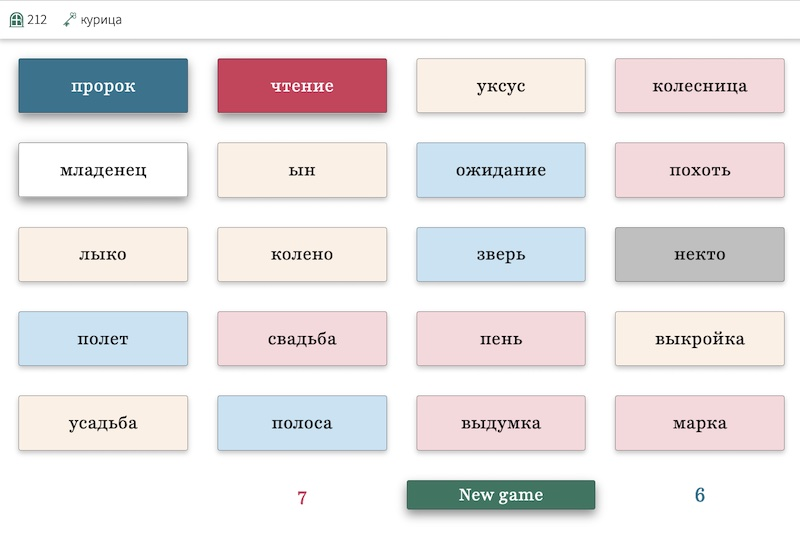
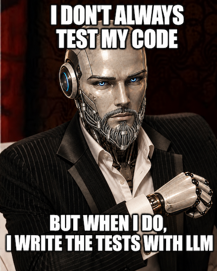

# Codenames

[](https://app.netlify.com/sites/friday-game/deploys)

A [Vue3](https://vuejs.org/) + [Ably](https://ably.com/) implementation of [Codenames](<https://en.wikipedia.org/wiki/Codenames_(board_game)>) board game.

## Motivation

Just a quick hobby project for me and my friends.



## Building

Call `git clone` and then `npm install` to get the deps, then run npm run build. The build tool is [Vite](https://vitejs.dev/), the compiled code goes into `/dist`.

## Deployment

tbd

## Development

### Auth

The roster of players is in `src/game/roster.ts`. The credential command prompts for the existing passwords of each player and stores salt and hashe in `PLAYER_CREDENTIALS`.

```bash
umask 077
npm run --silent credentials -- --local > .dev.vars
```

Sessions last 12 hours. Production cookies use `HttpOnly`, `Secure`, `SameSite=Strict`, the local command enables HTTP cookies only on loopback hosts through `ALLOW_LOCAL_HTTP=true`.

### Local run

For login to work create `.dev.vars` as described above, then run `npm run dev:worker`, and open http://localhost:8787. Restart that command after frontend changes to rebuild the app.

## Testing



## License

[MIT](https://github.com/eiri/codenames/blob/master/LICENSE)
